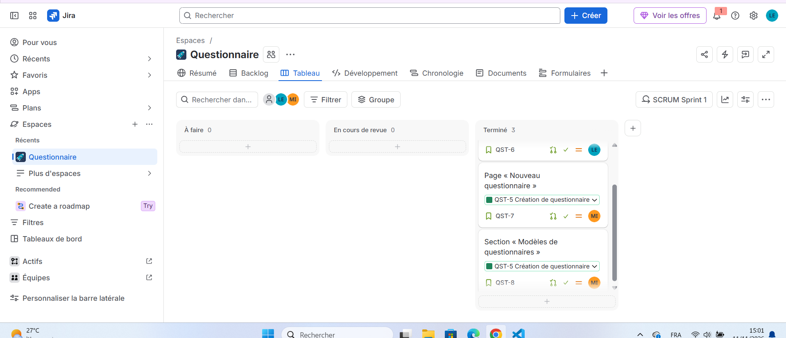

# Livrable TP1

- Membre A : Loukil Emna (@emnaloukil)
- Membre B : Aissaoui Maha (@maha-aissaoui)
- Fork : https://github.com/emnaloukil/devops2-tp1
- Site Jira : https://quizzoemna.atlassian.net
- QST-2 : réalisée par A (Emna)
- QST-3 : réalisée par B (Maha)
- QST-4 (bonus) : réalisée 
- Liaison Jira ↔ GitHub (bonus) : réalisée

